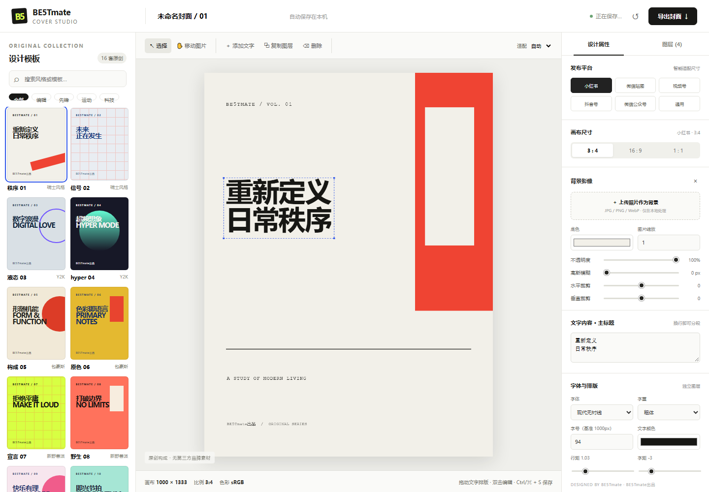

# BE5Tmate COVER STUDIO

一个面向社交媒体封面的本地设计工作台。单文件、零依赖，所有编辑和导出都在浏览器本地完成。

**在线体验：** https://be5tmate.github.io/be5tmate-cover-studio/



## 功能

- **16 套原创模板**：覆盖瑞士风格、Y2K、包豪斯、新野兽派、孟菲斯、装饰艺术、卡带未来主义与蒸汽波等视觉方向。
- **多平台尺寸**：内置小红书、微信贴图、视频号、抖音号、微信公众号和通用画布预设，支持 3:4、16:9、1:1 比例。
- **文字图层编辑**：添加、复制、删除、拖动和双击编辑文字，可调整字体、字号、字重、颜色、对齐、字距、行距、旋转和透明度。
- **背景影像控制**：上传本地图片作为背景，支持缩放、水平/垂直裁剪、透明度与高斯模糊调整。
- **超清导出**：支持 PNG、WebP 和 JPEG，最高可按 6× 倍率导出。
- **自动保存**：项目状态保存在浏览器 `localStorage` 中，刷新页面后仍可继续编辑。
- **完全本地**：无账号、无后端、无网络请求；上传的背景图不会离开本机。

## 技术栈

- 原生 HTML、CSS 和 JavaScript
- Canvas 2D 负责画布渲染与图片导出
- 无第三方运行时依赖，无构建步骤

## 本地运行

直接双击 `index.html` 即可使用。也可以启动一个本地静态服务器：

```bash
python -m http.server 8000
```

然后访问 `http://localhost:8000`。

## 部署到 GitHub Pages

仓库已包含 `.github/workflows/deploy-pages.yml`，推送到 `main` 分支即可自动部署。

1. 在 GitHub 创建仓库并推送本项目。
2. 打开仓库的 **Settings → Pages**。
3. 在 **Build and deployment → Source** 中选择 **GitHub Actions**。
4. 等待 `Deploy to GitHub Pages` 工作流完成，访问 Pages 显示的站点地址。

## 项目结构

```text
.
├── .github/
│   └── workflows/
│       └── deploy-pages.yml
├── .gitattributes
├── .gitignore
├── LICENSE
├── README.md
├── index.html
└── preview.png
```

## 浏览器支持

建议使用最新版 Chrome、Edge、Firefox 或 Safari。导出高倍率图片时，浏览器需要足够的内存。

## License

代码以 [MIT License](./LICENSE) 开源。`BE5Tmate` 名称与品牌标识不在 MIT 授权范围内。
